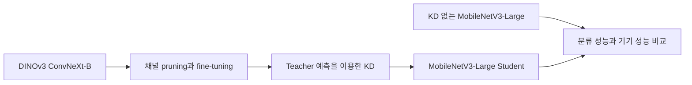

# Teacher Pruning과 Knowledge Distillation

<p align="center">
  
</p>

**Teacher를 얼마나 압축해도 Student의 분류 성능이 유지될까?**

Teacher 모델의 일부 채널을 제거한 뒤, 그 모델의 예측을 활용해 학습한 경량 Student의 성능을 비교하는 수업 팀 프로젝트다. 외형이 비슷한 새 종류를 구분하는 문제에서 Teacher의 크기와 계산량 감소가 Student의 정확도에 어떤 영향을 주는지 살펴본다.

온디바이스 AI 수업에서 배운 경량화 기법과 평가 방법을 직접 구현하며 실습하는 것도 목표다.

**현재 CUB 결과:** Git B-0 기반 Taylor + CE + KL 가지치기 30%/50%/70%와 B-0/30/50/70 Teacher의 Student KD 실험을 완료했다. [가지치기 노트북](notebooks/teacher_B30_50_70_Taylor_CE_KL_from_B0_colab.ipynb), [KD 노트북](notebooks/kd_Taylor_CE_KL_from_B0_colab.ipynb), [실행과 복원 안내](experiments/cub_taylor_kd/README.md), [실제 결과와 검증 근거](docs/results/cub_taylor_ce_kl_from_b0/README.md)를 제공한다. 가중치는 기존 방식대로 Drive 링크와 SHA-256으로 관리한다. 아래 본문은 초기 구현과 연구 계획이며 최신 CUB 완료 범위는 연결된 결과 문서를 기준으로 확인한다.

## 무엇을 비교하는가

| 용어 | 이 프로젝트에서의 의미 |
| --- | --- |
| Teacher | Student 학습에 참고할 예측을 제공하는 모델 |
| Student | 모바일 환경에서 사용할 경량 이미지 분류 모델 |
| Pruning | 모델의 일부 채널을 제거하는 압축 방법 |
| Knowledge Distillation, KD | 정답 라벨과 Teacher의 예측을 함께 활용해 Student를 학습하는 방법 |
| Hard-class | 기준 Teacher가 검증 데이터에서 자주 혼동하는 클래스 |

Teacher는 **DINOv3 ConvNeXt-B**, Student는 **ImageNet 사전학습 MobileNetV3-Large**를 사용할 계획이다. 두 모델의 분류 출력은 CUB의 200개 클래스에 맞춘다.



| 조건 | Teacher | Student 학습 |
| --- | --- | --- |
| Baseline | 사용하지 않음 | 정답 라벨로 학습 |
| B-0 KD | 압축하지 않은 Teacher | 정답 라벨과 Teacher 예측으로 학습 |
| B-30 KD | 대상 채널의 30%를 제거한 Teacher | 정답 라벨과 Teacher 예측으로 학습 |
| 후속 조건 | 50%, 70% 제거 검토 | 같은 Student 구조로 비교 |

Pruning 대상은 ConvNeXt 블록의 MLP expanded hidden channel이며, L1 norm을 중요도 기준으로 사용할 계획이다. 압축 비율은 대상 채널의 제거 비율로 정의하고, 전체 parameter 수와 MACs 감소율은 별도로 측정한다.

모든 조건에서 Student 구조는 동일하다. Teacher 압축이 Student의 크기나 지연 시간을 자동으로 줄이는 것은 아니다. 핵심은 **더 작은 Teacher가 어느 수준까지 Student를 잘 학습시킬 수 있는지** 확인하는 것이다.

## 데이터와 전처리

첫 데이터셋은 [CUB-200-2011](https://www.vision.caltech.edu/datasets/cub_200_2011/)이다. 총 11,788장, 200개 새 클래스로 구성된다. 외형이 유사한 클래스가 많은 데이터셋 두 개를 추가로 선정할 예정이다.

공식 학습 데이터 5,994장에서 클래스별 사진을 섞고 약 20%를 검증용으로 분리한다. 공식 테스트 5,794장은 그대로 유지한다.

| 분할 | 이미지 수 | 용도 | 배치 수, batch size 32 |
| --- | ---: | --- | ---: |
| 학습 | 4,794 | 모델의 가중치 학습 | 150 |
| 검증 | 1,200 | 모델 선택과 Hard-class 선정 | 38 |
| 테스트 | 5,794 | 실험 설정 확정 후 최종 평가 | 182 |

분할에는 Python의 `random.Random(42)`를 사용한다. 실제 이미지 ID 목록과 생성 기준은 [docs/splits](docs/splits/README.md)에 저장한다. 분할 seed와 모델 학습 seed는 별개이며, 학습 seed와 반복 조건은 모델 실험 전에 정한다.

현재 구현한 전처리는 다음과 같다.

- 크기: 종횡비를 유지하며 224×224로 맞추고 회색 RGB `(128, 128, 128)`으로 padding한다.
- 학습용: 좌우 반전 확률 0.5, 밝기 배율 0.9~1.1을 적용한 뒤 padding한다.
- 검증과 테스트: 무작위 어그멘테이션 없이 padding한다.
- 텐서: RGB 이미지를 `[3, 224, 224]` 형태의 `float32`로 변환한다.
- 정규화: Student 사전학습 기준인 mean `[0.485, 0.456, 0.406]`, std `[0.229, 0.224, 0.225]`를 사용한다. [공식 설정](https://docs.pytorch.org/vision/stable/models/generated/torchvision.models.mobilenet_v3_large.html)

중앙 자르기는 새의 일부가 잘리는 사례를 확인하여 기본 전처리에서 제외했다. 비교 이미지는 노트북에 남겼다. Teacher의 입력 크기와 정규화는 사용할 가중치에 맞춰 별도로 확인할 예정이다.

## 평가 계획과 진행 상태

Teacher의 parameter 수, MACs와 정확도를 측정하고, Student의 전체 정확도, Hard-class 정확도, KD Gain을 비교한다. KD Gain은 같은 조건의 KD 없는 Baseline 대비 정확도 차이이며 단위는 퍼센트포인트다. 이후 FP32와 INT8 성능, Android CPU 지연 시간을 측정한다.

Hard-class는 B-0 Teacher의 검증 결과로 선정하고 모든 비교 조건에 같은 목록을 사용한다. 현재 검증 이미지는 클래스당 6장이므로 클래스 선정의 안정성을 본실험 전에 검토해야 한다. 테스트 결과를 보고 클래스나 학습 설정을 선택하지 않는다.

| 상태 | 작업 |
| --- | --- |
| 완료 | 이미지 확인, 라벨 연결, 학습과 검증 분할 |
| 완료 | padding, 어그멘테이션, 텐서 변환과 정규화 |
| 완료 | 학습, 검증, 테스트 Dataset과 DataLoader |
| 다음 단계 | KD 없는 MobileNetV3-Large Baseline 학습 |
| 예정 | B-0 Teacher와 B-30 Teacher 준비, KD 비교 |
| 예정 | 추가 데이터셋 두 개, 압축 비율 확장, 조건별 3회 반복 |
| 예정 | INT8 평가와 Android CPU 지연 측정 |

2026년 10월 29일 pilot은 CUB에서 Baseline, B-0 KD, B-30 KD의 동작과 FP32/INT8 평가를 확인하는 목표다. 정확도나 지연 시간 결과는 아직 없다. 학습 장비, Teacher 가중치 접근, KD 설정, 학습 seed와 Hard-class 선정 규칙은 실험 전에 확정한다.

## 실행 방법

### 1. 환경 준비

저장소를 내려받고 프로젝트 루트에서 실행한다. 확인한 환경은 macOS, Python 3.11.4이며 직접 사용하는 패키지 버전은 [requirements.txt](requirements.txt)에 기록했다. 다른 운영체제나 GPU 환경에서는 PyTorch 설치 호환성을 확인한다.

```bash
python3 -m venv .venv
source .venv/bin/activate
python -m pip install -r requirements.txt
python -m ipykernel install --user --name ondeviceai --display-name "ondeviceAI"
python -m notebook
```

각 명령은 가상환경 생성, 활성화, 패키지 설치, 노트북 커널 등록, Jupyter 실행 순서다. Windows에서는 활성화 명령 대신 `.venv\Scripts\activate`를 사용한다. 새 가상환경에 패키지를 설치하는 절차는 별도로 검증하지 않았으며, 기록된 기존 환경에서 노트북 실행을 확인했다.

### 2. 데이터 준비

[공식 배포 페이지](https://www.vision.caltech.edu/datasets/cub_200_2011/)에서 이미지를 내려받아 다음 구조로 배치한다. 사진과 원본 메타데이터는 GitHub 저장소에 포함하지 않는다.

```text
data/
└── CUB_200_2011/
    └── CUB_200_2011/
        ├── images/
        ├── images.txt
        ├── image_class_labels.txt
        ├── classes.txt
        └── train_test_split.txt
```

다른 위치에 데이터를 두었다면 노트북 첫 코드 셀의 `data_dir`만 수정한다.

### 3. 노트북 실행

[notebooks/dataLoader.ipynb](notebooks/dataLoader.ipynb)를 열고 `ondeviceAI` 커널을 선택한 뒤 위에서부터 실행한다. 프로젝트 루트 또는 `notebooks/`를 작업 디렉토리로 사용할 수 있다.

노트북은 `데이터 준비 → 이미지 전처리 → Dataset과 DataLoader` 순서다. 원본 이미지, crop과 padding 비교, 반전과 밝기 예시를 확인한 뒤 배치 형태를 출력한다.

데이터 읽기, 분할, 전처리와 DataLoader 생성은 [data_loader.py](data_loader.py)에 정의한다. `dataLoader.ipynb`와 [baseline.ipynb](notebooks/baseline.ipynb)는 이 모듈을 import하며, Baseline 실행 전에 데이터 실습 노트북을 실행할 필요는 없다. 공통 데이터 처리 방식을 바꿀 때는 이 모듈을 수정한다.

```text
이미지 배치: torch.Size([32, 3, 224, 224])
레이블 배치: torch.Size([32])
레이블 자료형: torch.int64
학습 배치 수: 150
검증 배치 수: 38
테스트 배치 수: 182
```

학습용은 순서를 섞으며, 검증과 테스트는 목록 순서를 유지한다. `num_workers=0`으로 실행하고 마지막 작은 배치도 사용한다. 무작위 어그멘테이션 때문에 학습용 예시 이미지는 실행마다 달라질 수 있다.

## 파일 구성과 협업

```text
ondeviceAI/
├── README.md
├── requirements.txt
├── AGENTS.md
├── .gitignore
├── data_loader.py              # 두 노트북에서 사용하는 공통 데이터 처리
├── notebooks/dataLoader.ipynb
├── notebooks/baseline.ipynb
├── docs/
│   ├── assets/                 # README 썸네일
│   ├── splits/                 # 공유할 분할 ID 목록과 생성 기준
│   └── *.md                    # 연구계획, 관련 연구, 실험 기록
├── data/                       # 로컬 데이터, Git 제외
└── outputs/                    # 실행 산출물, Git 제외
```

코드, 문서, 환경 설정과 분할 목록을 공유한다. 데이터, 가중치, 다운로드 압축파일, 로그, 개인 환경 파일은 `.gitignore`로 제외한다. 노트북의 필요한 샘플 출력은 유지한다. 공유할 실험 결과는 `outputs/`에서 필요한 표와 그림만 골라 `docs/`에 옮긴다.

커밋은 `feat: 검증용 DataLoader 추가`처럼 Conventional Commits 형식을 사용하고 목적별로 나눈다. 원격 push는 사용자가 직접 진행한다.

## 상세 문서와 출처

- [연구계획](docs/연구계획.md): 연구 질문, pruning과 KD 설계, 평가 지표
- [이번 주 계획](docs/이번주계획.md): pilot 비교 조건
- [학습과 실습 순서](docs/학습실습계획.md): PyTorch 실습 진행 순서
- [데이터셋 선정](docs/데이터셋선정.md): CUB 정보와 추가 데이터셋 조사
- [관련 연구](docs/관련연구1.md): 연구 배경이 되는 논문 정리
- [실험 기록 양식](docs/실험기록양식.md): 조건, 결과와 해석 기록

썸네일은 CUB-200-2011의 이미지 ID `3406`, `059.California_Gull/California_Gull_0001_40786.jpg` 원본이다. 데이터셋 출처는 [Caltech의 CUB-200-2011 배포 페이지](https://www.vision.caltech.edu/datasets/cub_200_2011/)이며, 인용 정보는 Wah et al., *The Caltech-UCSD Birds-200-2011 Dataset*, 2011이다.

공식 배포 안내는 이미지 사용을 비상업적 연구와 교육 목적으로 제한하고, 배포 기관이 이미지 저작권을 소유하지 않는다고 명시한다. 썸네일과 노트북의 샘플 이미지에는 원본 이미지의 권리가 적용되며, 이 저장소가 이미지의 재사용 권한을 별도로 부여하지 않는다.
